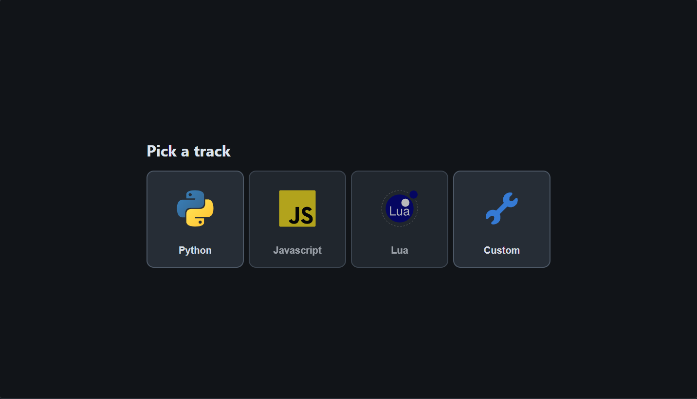
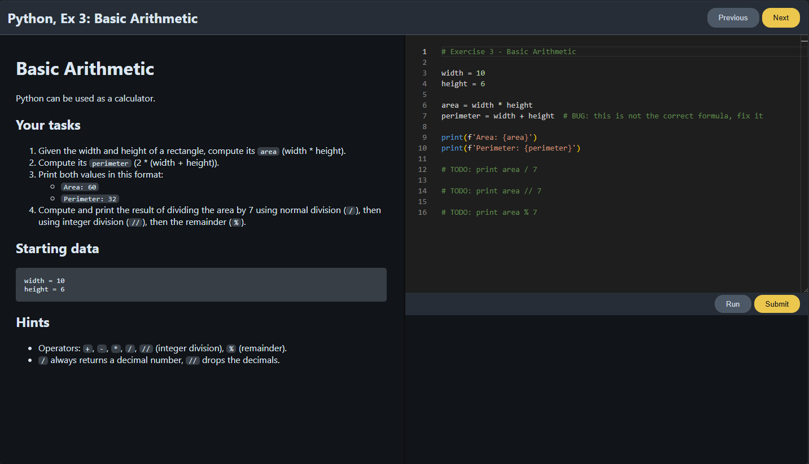
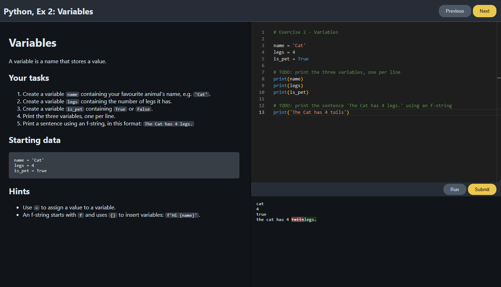

# CodeBook
the free place for all your programming courses

> [!WARNING]
> Currently, no tracks are included in the public version. We are currently working on getting good tracks for Python, Javacript, Lua, and more!
> you can still view your own track tho.

CodeBook is a fully free webapp for interactive programming courses. Either pick from one of the official courses (tracks) or the many community made ones.

### everything is local!
in CodeBook, your progress is tracked locally, no account needed.

### languages supported by the notebook
- Python

## track selection

## notebook

